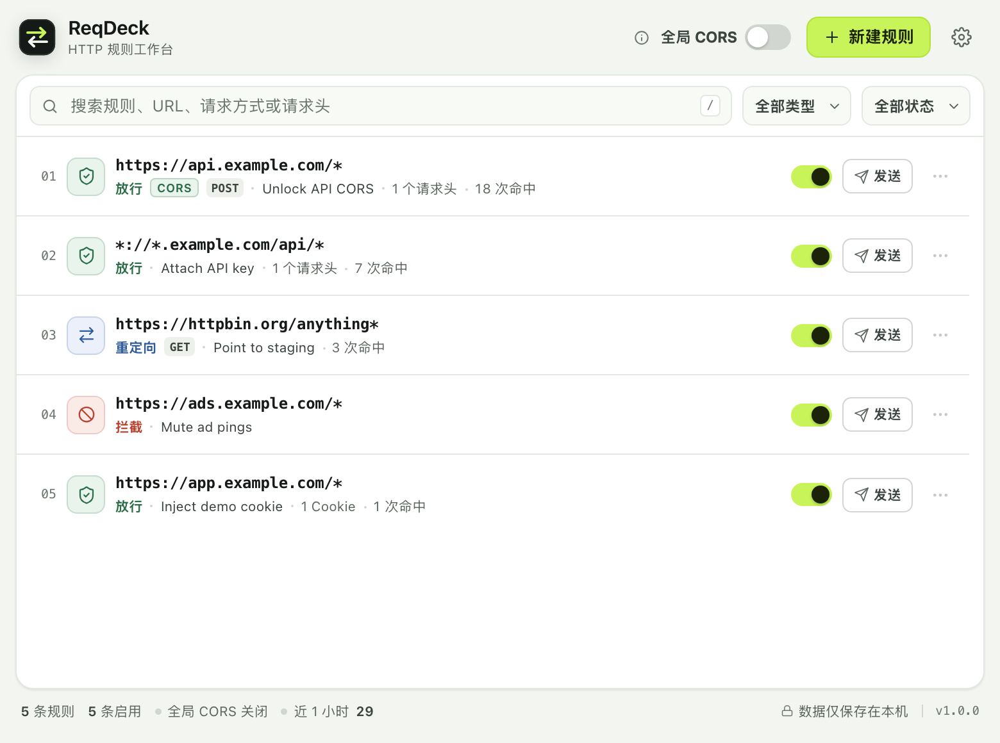
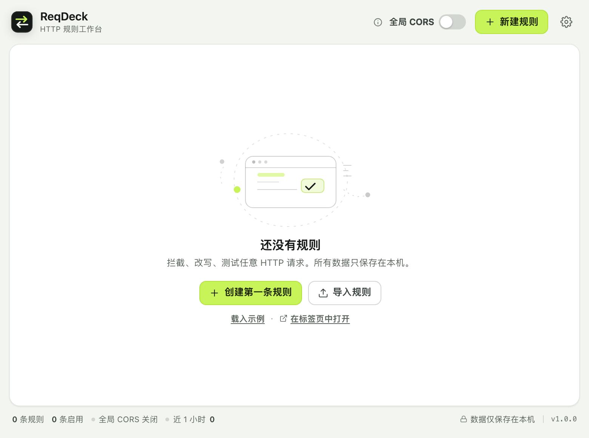
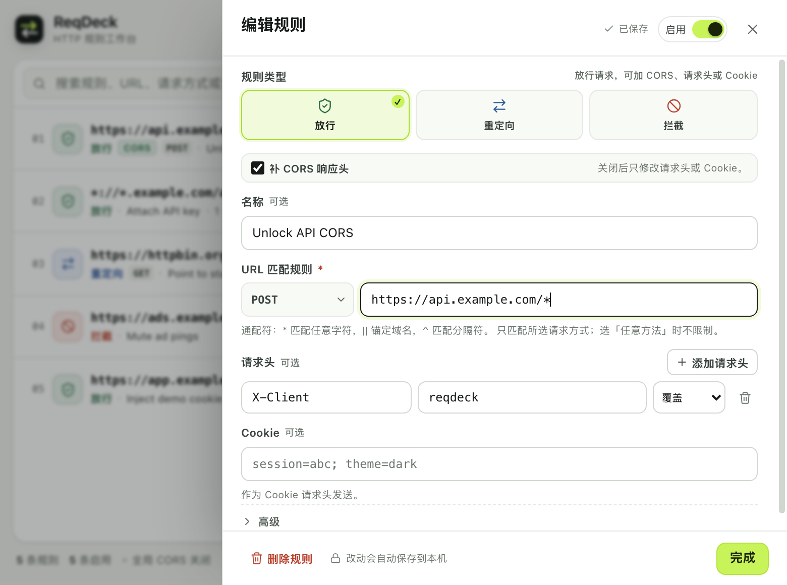
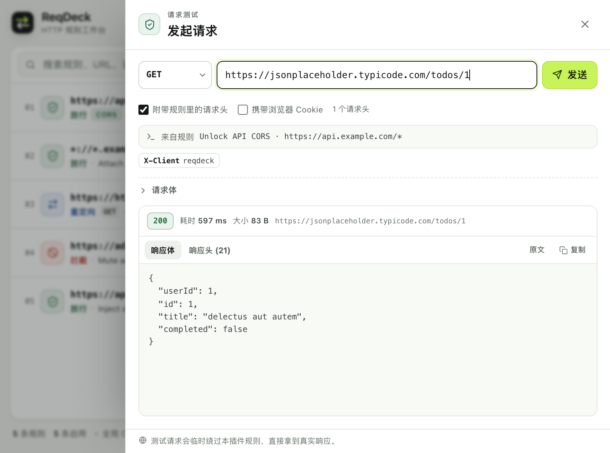
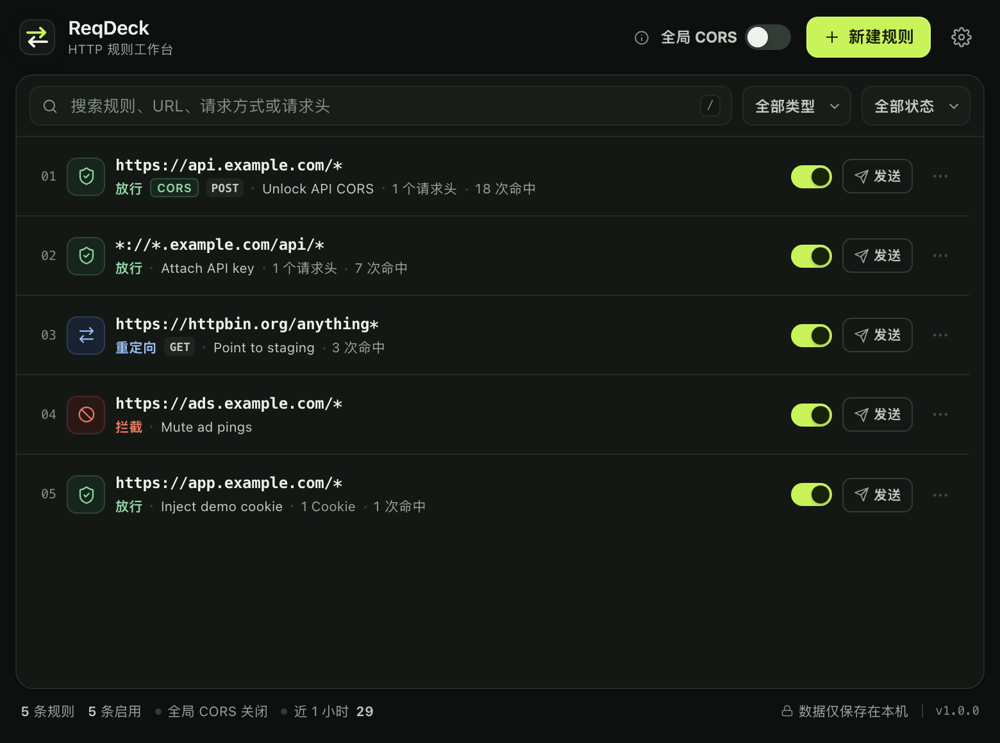

# ReqDeck

ReqDeck 是一个本地优先的 Chromium HTTP 规则工作台，用来在 API 联调、跨域调试和前端开发中快速控制浏览器请求。规则编辑、启停、命中统计和请求测试都在一个紧凑的弹窗里完成，也可以打开独立标签页使用。

它不依赖账号或远端服务：规则、设置、草稿和测试信息只保存在当前浏览器；改动自动保存，新建规则有草稿恢复；每条规则都可以直接发请求验证结果。



## 功能

- **三种规则**：放行、重定向、拦截。放行规则可以补 CORS 响应头，也可以附带请求头或 Cookie；重定向和拦截只做转发或阻断。
- **全局 CORS**：一键给所有页面的跨域响应补上 CORS 头。
- **列表内直接发请求**：按行测试，支持 Method、URL、请求体、附带规则请求头、携带浏览器 Cookie。
- **响应查看器**：状态码、耗时、大小、最终 URL、响应头、JSON 格式化、原文切换、一键复制。
- **本地命中统计**：每行显示命中次数，底部显示最近 1 小时命中数；可关闭统计或清零。
- **请求方式匹配**：默认「任意方法」，也可以只匹配 GET、POST、PUT、PATCH、DELETE、HEAD 或 OPTIONS。
- **搜索与筛选**：按 URL、名称、请求方式、请求头内容搜索；按类型、状态筛选。
- **导入 / 导出**：JSON 备份与迁移，支持合并或整体替换。
- **紧凑列表 + 侧滑编辑器**：不离开列表就能完成编辑；狭小弹窗之外还有「在标签页中打开」的全屏工作台。
- **中英文 + 深色模式**：默认跟随系统语言，深色跟随系统或手动切换。
- **无构建步骤、无第三方运行时依赖**：加载已解压目录即可使用。

## 安装

1. 下载或解压本项目到任意目录。
2. 打开 `chrome://extensions`（Edge 为 `edge://extensions`）。
3. 打开右上角「开发者模式」。
4. 点击「加载已解压的扩展程序」，选择本项目根目录（包含 `manifest.json` 的那一层）。
5. 建议把 ReqDeck 固定到工具栏。

本地安装/更新请用完整包 `dist/reqdeck-1.0.0.zip`。无需 `npm install`，无需构建。

### 关于「每次拖 zip 都变成新插件」

Chrome 对没有固定身份的未打包扩展，会按加载路径生成扩展 ID。把 zip 拖进去时，如果浏览器每次解压到不同的临时目录，ID 就会变化，`chrome.storage.local` 里原来的规则也就读不到了。

完整包在打包时会写入一个固定的 manifest `key`；公钥不放进仓库。本地构建从 `.keys/extension-public.txt` 读取（已 gitignore），GitHub Actions 则从 `EXTENSION_PUBLIC_KEY` secret 读取。后续使用同一个 key 的包会保持同一个扩展 ID，规则、设置和统计都会继续使用同一份本地数据。

**第一次从旧的无 key 安装切换时，ID 会变化一次，旧数据不会自动迁移。** 请先在旧插件里打开设置菜单导出规则，安装新的完整包后再导入。之后更新只需加载新的完整包，数据会保留。

如果你完全不想使用固定 `key`，也可以把源码放在一个固定目录，用「加载已解压的扩展程序」加载；以后覆盖同一个目录并点刷新，路径不变，ID 和数据也不变。但这要求始终使用同一个目录，拖 zip 仍然会变。

私钥在 `.keys/extension-private.pem`，公钥在 `.keys/extension-public.txt`；两者都不要提交，私钥不要发给别人。GitHub secret 和 fork 的处理见下文「扩展 ID 与 key」。

支持 Chromium 内核浏览器，要求 Chrome 116+；在 Chrome 158 上完整验证过。Firefox 使用不同的 MV3 规则接口，暂未适配。

## 使用

### 新建规则

点击「新建规则」，选择类型、请求方式（默认任意）并填写 URL 匹配规则。匹配规则使用 Chrome `declarativeNetRequest` 的 URL filter 语法：

| 写法 | 含义 |
| --- | --- |
| `https://api.example.com/*` | 匹配该域名下的任意路径 |
| `*://*.example.com/*` | 匹配 http/https 的任意子域名 |
| `||example.com^` | 匹配 `example.com` 及其子域，`^` 表示分隔符 |
| `https://example.com/api/*` | 精确到路径前缀 |

请求方式默认「任意方法」。选择具体方法后，DNR 规则和本地命中统计都会按该方法过滤；CORS 放行规则会自动把预检 `OPTIONS` 也纳入响应头修改，避免带自定义请求头的 POST/PUT 在预检阶段失败。

三种类型的语义：

- **放行**：放行匹配请求。默认补 `Access-Control-Allow-Origin: *` 等 CORS 响应头，可以在编辑器里关掉，只保留请求头 / Cookie 修改；也可以关闭 CORS 后当作纯请求头规则使用。
- **重定向**：把请求转发到固定目标地址。目标地址不支持通配符替换。
- **拦截**：在请求发出前直接阻断。

请求头和 Cookie 是放行规则的可选附加项，不再是独立类型；重定向和拦截只保留各自的 URL（重定向还保留目标地址）。Chrome 对「追加」任意自定义请求头有限制，因此请求头只有「覆盖 / 删除」两种操作。

规则按列表顺序生效，**后面的规则优先级更高**；全局 CORS 的优先级最低。列表序号可用于判断覆盖关系。

### 弹窗显示过窄？

Chrome 正常会按 780×580 打开扩展弹窗。如果某个 Chromium 外壳把扩展弹窗嵌进固定宽度的侧栏或菜单里，ReqDeck 会在加载后自动切换为紧凑布局，保证按钮和编辑器仍然可用；你也可以点击空状态或设置菜单里的「在标签页中打开」，获得完整宽度的工作台。

旧版本中有一个在窄视口下把 `body` 锁成 `100vw` 的媒体查询，这正是弹窗被压到很窄后无法恢复的原因；现在已移除，并改为延迟检测、仅在确实被限制时启用紧凑布局。



### 自动保存与草稿



- 编辑已有规则时，任何改动约 300ms 后自动写入本机，不需要点「保存」；关闭弹窗、切换窗口、直接点「完成」都不会丢。
- 新建规则时，输入内容会保存为草稿。弹窗关闭后重新打开，列表顶部会出现草稿条，可以「继续编辑」或「丢弃」。
- 页面关闭（`pagehide`）时还会强制刷写一次，覆盖最后一个输入。
- 需要长时间编辑时，可以从设置菜单选择「在标签页中打开」。

### 在列表内发请求



点击任意规则行的「发送」：

1. 自动填入从 URL 规则推导出的可访问地址；通配符无法直接访问，可在输入框中修改。
2. 自动带上规则中配置的请求头（可关闭）。
3. 请求由扩展 Service Worker 携带站点权限发出，因此不受页面 CORS 限制，能直接读到响应。
4. 测试请求会通过一条**仅对本次 URL 生效、临时加入又马上删除**的 session allow 规则，绕过你已启用的拦截 / 重定向规则，避免「测自己的拦截规则时永远失败」。
5. 响应会展示状态、耗时、大小、最终地址、响应头和响应体；响应体上限 512 KB，JSON 默认格式化。

测试器不能手动设置 `Cookie` 请求头（fetch 的禁止头）。规则里的 Cookie 字符串会由规则本身在真实流量中注入；测试请求可以勾选「携带浏览器 Cookie」使用当前浏览器已有的 Cookie。

### 全局开关与统计



- 顶部的「全局 CORS」开关会为所有页面请求追加 CORS 响应头。
- 每行末尾的开关启用 / 暂停单条规则；设置菜单里可以全部启用或全部暂停。
- 命中统计只观察**命中了规则的页面请求**，不记录 URL，只累计次数。可以在设置菜单关闭统计或清零。

### 导入 / 导出

- 导出会生成 `reqdeck-rules-YYYYMMDD.json`。
- 导入支持本插件导出的对象，也接受规则数组；可合并到现有列表或整体替换。
- 导出文件包含请求头、Cookie 等可能敏感的内容，请妥善保管。

## 数据与隐私

- 所有数据只写入当前浏览器配置下的 `chrome.storage.local`。
- 没有账号、没有云同步、没有统计 SDK、没有远程配置；除「发送」按钮发起的请求外，扩展不会主动联网。
- 权限说明：
  - `storage`：保存规则、设置、草稿和命中统计。
  - `declarativeNetRequest` + `<all_urls>`：对用户配置的任意域名应用请求/响应头、重定向和拦截规则；URL 规则本身可以指向任何站点，所以需要全站权限。
  - `webRequest`：只读地观察请求是否命中规则，用于本地命中计数；不修改请求，不上传数据。
- 卸载扩展或在浏览器中清除扩展数据会删除所有规则，请先导出备份。

## 已知限制

- CORS 放行使用 `Access-Control-Allow-Origin: *`。带凭据（credentials）的跨域请求要求服务器回显具体 Origin，Chrome 的响应头修改无法动态回显，因此这类场景不适用。
- 重定向目标必须是固定 URL，不会替换通配符；Chrome 的 `redirect.url` 在未使用 regex 规则时不支持变量替换。
- Chrome 不允许 DNR 对任意自定义请求头做「追加」，所以请求头只有「覆盖 / 删除」两种操作。
- 测试器不发送规则中的 Cookie 字符串，也不能手动设置 `Cookie` 头；请在真实页面流量中使用规则里的 Cookie 字段。
- 测试器绕过规则的行为是一次性、精确 URL 的 session 规则；如果插件 Service Worker 在请求期间被回收，该规则会在下次启动时清理。
- 规则数量上限 800，以保证生成的 DNR 规则远低于 Chrome 的动态规则上限。
- 数据不会跨设备同步；需要迁移时请使用导出 / 导入。
- 仅支持 Chromium 的 Manifest V3；Firefox 暂未适配。

## 项目结构

```text
manifest.json          MV3 清单
src/
  background.js        Service Worker：DNR 同步、本地命中统计、请求测试
  app.js               弹窗 / 工作台 UI 控制器
  core.js              规则模型、校验、DNR 编译、URL filter 匹配
  store.js             chrome.storage.local 持久化
  i18n.js              中英文文案
  icons.js             内联图标与插图
  styles.css           设计系统与全部样式
  popup.html           主界面
  options.html/js      设置入口（重定向到全屏工作台）
icons/                 扩展图标（脚本生成）
tests/                 Node 内置测试
scripts/
  make-icons.mjs       图标生成
  package.mjs          本地打包（注入固定 key）
  keygen.mjs           生成自己的扩展 key
  release.mjs          版本号、CHANGELOG、tag、push
  extract-release-notes.mjs
.github/workflows/     CI 与 tag 发布工作流
CHANGELOG.md           只在发布时由脚本更新
.keys/                 本地 key（gitignored，不提交）
docs/                  截图
```

## 开发

无需安装依赖。

```bash
npm test                  # 规则模型 / DNR 编译 / i18n 完整性测试
npm run check             # node --check 语法检查
node scripts/make-icons.mjs
npm run keygen            # 生成本地 key；已有 key 时只打印 ID
npm run package           # 生成带固定 key 的 dist/reqdeck-<version>.zip
npm run release -- patch  # 发布：版本、CHANGELOG、commit、tag、push
```

图标由 `scripts/make-icons.mjs` 纯代码生成，不需要图片处理库。

## 发布

发布由本地脚本和 GitHub Actions 配合完成，**不在 GitHub 上手动改版本或 CHANGELOG**：

1. 先把代码和文档全部提交，确保工作区干净。
2. 运行发布脚本：
   ```bash
   npm run release -- patch     # 或 minor / major
   # 首次还没有历史 tag 时，也可以直接发当前版本：
   npm run release -- 1.0.0
   ```
3. 脚本会依次执行测试和语法检查，更新 `manifest.json` 与 `package.json` 的版本号，从**上一个 `v*` tag 到当前 HEAD** 的所有 commit 生成 `CHANGELOG.md` 条目，提交 `chore(release): vX.Y.Z`，创建并推送版本 tag。
4. tag 推送后，`.github/workflows/release.yml` 会在 GitHub Actions 中测试、打包，并把 `reqdeck-<version>.zip` 发布到 GitHub Release，Release Notes 取自 CHANGELOG 对应版本。
5. `CHANGELOG.md` 只能由 `npm run release` 修改；普通 PR 如果改了 CHANGELOG，CI 会直接失败。

发布脚本要求：工作区干净、已配置 `git user.name` / `user.email`、已设置 `origin` 远程。它不会在测试失败时改文件或打 tag。

## 扩展 ID 与 key

扩展 ID 由 manifest 里的固定 `key` 决定。这个 key **不提交进仓库**：

- 本地：`.keys/extension-public.txt`（公钥）和 `.keys/extension-private.pem`（私钥）。`.keys/` 已在 `.gitignore` 中。
- GitHub Actions：`EXTENSION_PUBLIC_KEY` 必须设置成你的公钥；`EXTENSION_PRIVATE_KEY` 可选，只有以后要签 CRX 时才需要。
- 设置位置：GitHub 仓库 → Settings → Secrets and variables → Actions → New repository secret。
  - `EXTENSION_PUBLIC_KEY`：`.keys/extension-public.txt` 的内容。
  - `EXTENSION_PRIVATE_KEY`：`.keys/extension-private.pem` 的内容（可选）。
- 当前项目的扩展 ID 是 `mcdmpanjicjphehaadhfckodlijgnehb`；把现有公钥加进 secret 后，后续发布仍然使用这个 ID。

**其他人克隆/ fork 后**：

1. 运行 `npm run keygen` 生成他们自己的 `.keys/`；
2. 把新公钥加到**他们自己仓库**的 `EXTENSION_PUBLIC_KEY` secret；
3. 再运行 `npm run release`。

每个人 key 不同，扩展 ID 就不同，不会和本项目的发布冲突。GitHub 不会把本仓库的 Actions secrets 继承给 fork；release workflow 在缺少 `EXTENSION_PUBLIC_KEY` 时会直接失败，因此 fork 不会误用本项目的 key。

## 版本

1.0.0
